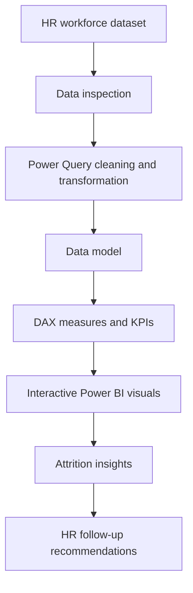

<!--
  HR Employee Attrition Analysis Dashboard
  Interactive GitHub README: collapsible sections, navigation, badges and Mermaid workflow.
-->

# 📊 HR Employee Attrition Analysis Dashboard

### Turning workforce data into actionable HR insights with Power BI

  
  
  
  

**An interactive, two-page Power BI report exploring employee attrition patterns, workforce demographics and potential retention drivers.**

---

## 🧭 Project navigation

- [🎯 Project overview](#-project-overview)
- [📌 Dashboard at a glance](#-dashboard-at-a-glance)
- [📊 Dashboard pages](#-dashboard-pages)
- [🔍 Business questions](#-business-questions)
- [💡 Key observations](#-key-observations)
- [🧹 Workflow](#-workflow)
- [🛠️ Tools and skills](#️-tools-and-skills)
- [▶️ How to explore the project](#️-how-to-explore-the-project)
- [👨‍💻 About the author](#-about-the-author)

## 🎯 Project overview

Employee attrition can affect hiring costs, team productivity and organizational knowledge. This project uses **Microsoft Power BI** to explore workforce data and help HR stakeholders investigate where attrition is concentrated and which employee characteristics may be associated with employees leaving.

The report is organized into two pages:
1. **Attrition Overview** – workforce KPIs and demographic/job-role breakdowns.
2. **Attrition Drivers and Insights** – salary, overtime, tenure and promotion-gap analysis.

> **Project purpose:** Support data-informed HR investigation. The patterns shown are associations in the dataset and should not be interpreted as proof that any single factor causes attrition.

## 📌 Dashboard at a glance

| Metric | Dashboard value |
|---|---:|
| Employees | 1,470 |
| Active employees | 1,242 |
| Inactive employees | 238 |
| Attrition rate | 16.08% |
| Average monthly income | 6.50K |
| Average tenure | 7.01 years |
| Average salary hike | 15.21 |

<strong>ℹ️ How to read these KPIs</strong>

- **Employees:** Total employee records represented in the dashboard.
- **Active / Inactive:** Employee status split used in the report.
- **Attrition rate:** The dashboard's reported percentage of employees who left.
- **Average monthly income:** Mean monthly income represented in the dataset.
- **Average tenure:** Mean employee tenure represented in the dataset.
- **Average salary hike:** Mean salary-hike value represented in the dataset.

The KPI values above are transcribed from the dashboard preview. Confirm the underlying DAX definitions and formatting in the PBIX before using them in formal reporting.

## 📊 Dashboard pages

<strong>Page 1 — Attrition Overview</strong>

Explore who is leaving the organization through:

- Employee count, active/inactive employees and attrition KPIs.
- Attrition patterns by age group.
- Attrition breakdown by marital status and gender.
- Job-role comparison to identify roles with higher reported attrition.
- Department and job-role slicers for interactive filtering.

**Questions explored:** Which age groups and job roles have higher attrition? How does the attrition pattern vary across demographic groups?

<strong>Page 2 — Attrition Drivers and Insights</strong>

Explore potential attrition-related patterns through:

- Salary-slab analysis.
- Overtime breakdown.
- Tenure-group comparison.
- Promotion-gap comparison.
- Department and job-role slicers.

**Questions explored:** How does attrition vary across salary bands, overtime status, tenure groups and time since the last promotion?

## 🔍 Business questions

1. What is the overall employee attrition rate?
2. Which age groups show higher attrition?
3. Which job roles have the highest reported attrition?
4. How does attrition vary across salary slabs?
5. Is attrition different for employees working overtime?
6. How does attrition vary with employee tenure?
7. Do employees with longer promotion gaps show different attrition patterns?

## 💡 Key observations

- The dashboard reports an overall attrition rate of **16.08%**.
- The **Sales Representative** role has the highest displayed job-role attrition rate (**39.3%**).
- The youngest age band shown (18–25) has the highest bar in the age-group visual.
- The salary-slab visual shows higher attrition in the lower salary bands.
- The overtime visual shows a larger share for employees marked **Yes**.
- The tenure and promotion-gap visuals highlight groups that HR may want to investigate further.

<strong>🧠 Suggested HR follow-up actions</strong>

- Review retention challenges and exit feedback for roles with higher attrition.
- Compare compensation, workload and career progression across salary bands.
- Investigate overtime distribution alongside role, department and tenure.
- Review onboarding and early-career support for newer employees.
- Explore promotion pathways and employee development opportunities.
- Validate these patterns with employee feedback and additional business context before making policy changes.

## 🧹 Workflow

## 🛠️ Tools and skills

| Tool / skill | How it is used |
|---|---|
| Microsoft Power BI | Dashboard development and data visualization |
| Power Query | Data cleaning and transformation |
| DAX | KPI and analytical measure creation |
| Data analysis | Attrition pattern exploration |
| Data storytelling | Communicating findings and recommendations |

## ▶️ How to explore the project

1. Open the repository and locate the Power BI `.pbix` report file.
2. Download the file and open it using **Power BI Desktop**.
3. Navigate between **Attrition Overview** and **Attrition Drivers and Insights**.
4. Use the Department and Job Role slicers to filter the report.
5. Select different chart categories to explore cross-filtering.

<strong>⚙️ Before opening the report</strong>

If Power BI prompts for a data source, update the source path in Power Query to the location of the dataset on your computer, then refresh the report. Do not publish confidential employee-level information.

## 👨‍💻 About the author

**Rehan Ansari**  
Aspiring Data Analyst | Power BI | SQL | Excel | Python

I enjoy transforming raw data into meaningful insights and building dashboards that support business decision-making.

- GitHub: [@rehanansari2517-qua](https://github.com/rehanansari2517-qua)
- LinkedIn: [Add your LinkedIn profile URL](https://www.linkedin.com/)

---

**If you find this project useful, consider giving the repository a ⭐**

*Built as a Data Analyst portfolio project using Microsoft Power BI.*

